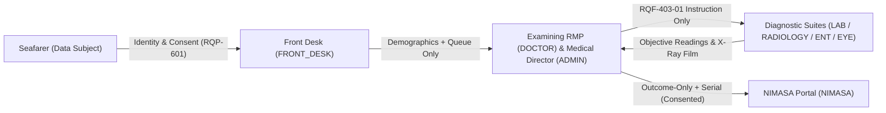

# Data Protection Impact Assessment (DPIA) & Application Security Assessment

**System:** Kingscare Hospitals Limited — Recognized Medical Practitioner (RMP) Quality Standards System Portal  
**Facility:** Plot 2181, Ibrahim Babangida Way, Wuse Zone 4, Abuja  
**Recognition Certificate:** `NIM-RMP-ABJ-2025-014`  
**Statutory & Regulatory Basis:**
- **Nigeria Data Protection Act (NDPA) 2023** — Sections 24 (Principles), 25–26 (Lawful Basis), 28 (Data Protection Impact Assessment), 30 (Sensitive Personal Data / Health Data), 34–38 (Data Subject Rights), 39 (Security of Processing), and 40 (Breach Notification — 72 hours to NDPC)
- **STCW Convention 1978 (as amended), Regulation I/9 & Code Section A-I/9**
- **NIMASA Merchant Shipping (Medical Examination of Seafarers) Regulations 2025 & RMP QSS Manual (`QA-P-808`, `RQP-404`, `RQP-701`, `RQP-801`, `RQP-802`, `RQP-803`)**

---

## Part 1 — NDPA 2023 §28 Data Protection Impact Assessment (DPIA)

### 1.1 Threshold & Necessity Screening (NDPA 2023 §28(1) & §30)
Under **NDPA 2023 §28(1)** and **§30**, a Data Protection Impact Assessment is mandatory prior to and during high-risk processing involving **sensitive personal data**, specifically **physical and clinical health records, diagnostic radiographs, audiograms, visual acuity measurements, and statutory fitness-for-duty determinations** affecting employment at sea.

### 1.2 Roles & Accountability Matrix
| Party | NDPA 2023 Role | Scope of Processing |
|---|---|---|
| **Kingscare Hospitals Limited** | **Data Controller** (Clinical Records) | Full STCW Reg. I/9 clinical examination, diagnostic investigations (Lab, X-Ray, ENT, Eye), confidential clinical case files (`QAF-804-01`), and 10-year statutory record retention (`RQP-801`). |
| **NIMASA (Maritime Labour / Safety Oversight)** | **Independent Statutory Recipient / Regulator** | Receives **outcome-only** fitness status (`Fit`, `Fit with limitation`, `Not fit`), certificate serial verification (`QAF-805-01`), and consented non-clinical stage progress (`QA-P-808`). **Never receives clinical diagnoses, medications, or raw diagnostic films.** |
| **Medical Director / QSS Lead (`ADMIN`)** | **Records Custodian & DPO Liaison** | Oversees individual account provisioning (`RQP-404 §5`), quarterly clinical peer review (`RQP-304`), restricted access logs (`RQR-802-01`), and 72-hour breach reporting (`RQP-803` / NDPA §40). |

### 1.3 Data Inventory & Strict Role-Scoped Minimization (`QA-P-808`)

| Data Category | Examples | `DOCTOR` / `ADMIN` | `FRONT_DESK` | `LAB` / `RADIOLOGY` / `ENT` / `EYE` | `NIMASA` |
|---|---|---|---|---|---|
| Identity & Demographics | Name, DOB, Gender, SID/Passport No., Entry vs. Periodic Exam | Full | Full | Referred patients only | Consented members only |
| Triage Vitals | BP, Temp, Pulse, SpO₂, Weight | Full | Redacted (`Restricted`) | Redacted (`Restricted`) | Redacted (`Restricted`) |
| Confidential Clinical Case File (`patient_clinical_notes`) | Initial diagnosis, handover notes, follow-up & peer-review notes | Full (Access Logged) | Stripped (`[]`) | Stripped (`[]`) | Stripped (`[]`) |
| Prescribed Medications | Drug name, dosage, duration | Full | Stripped (`[]`) | Stripped (`[]`) | Stripped (`[]`) |
| Diagnostic Orders & Attached Films/Reports | Chest X-Ray film, PDF lab/audiogram, scientist remarks | All departments | Stripped (`[]`) | **Own department only** | Status only (`Completed`; attachment blocked `403`) |
| Statutory Fitness Outcome & Certificate | `Fit` / `Limited` / `Not fit`, `QAF-805-01` serial, expiry | Full + clinical basis | Outcome & cert serial (no basis) | Stripped | Outcome & cert serial (basis redacted) |

### 1.4 Lawful Basis of Processing (NDPA 2023 §§25 & 30)
1. **Statutory / Legal Obligation (§25(1)(b)(iii) & §30(1)(b)):** Conducting STCW Reg. I/9 medical examinations, maintaining 10-year clinical records (`RQP-801`), and responding to genuine/forged certificate serial enquiries (`RQP-703`).
2. **Preventive & Occupational Medicine (§30(1)(d)):** Processing health data under the responsibility of MDCN-licensed medical practitioners bound by statutory professional secrecy.
3. **Explicit Informed Consent (§25(1)(a) & §26):** Recorded at registration (`RQF-601-02`) before sharing live non-clinical stage tracking with a sponsoring agency (`consentToShareWithNimasa`), with **live right of withdrawal** (`PATCH /api/patients/:id/privacy-consent`).

### 1.5 Privacy Risk Assessment & Mitigations (NDPA §28(2))
| ID | Privacy / Data Protection Risk | Inherent Risk | Technical & Organisational Control Implemented | Residual Risk |
|---|---|---|---|---|
| **DP-01** | Unauthorized disclosure of confidential diagnosis or HIV/TB/medication notes to sponsor/employer (`QA-P-808`) | **Critical** | Server-side redaction in `getFullBootstrap` (`redactForNimasa`, `redactForFrontDesk`, `redactForDiagnosticDept`) strips `clinicalNotes`, `medications`, `vitals`, and `determinationBasis` before serialization. | **Low** |
| **DP-02** | Cross-department snooping (e.g., Eye Clinic viewing ENT or Lab orders, or downloading Chest X-Ray films) | **High** | Department-level RBAC + IDOR guard (`ensureOrderDepartmentAccess`) enforces `403` on `/draft`, `/publish`, and `/attachment` across departments; bootstrap filters patients to own-department referrals only. | **Low** |
| **DP-03** | Multi-doctor handover overwriting prior doctor's clinical findings or unlogged browsing of clinical files | **High** | Append-only `patient_clinical_notes` table preserves every doctor's signed entry chronologically; opening the clinical file triggers `POST /api/patients/:id/record-access` (`RESTRICTED_RECORD_ACCESSED` in `audit_logs` per `RQP-802 §7.2.1`). | **Low** |
| **DP-04** | Orphaned X-Ray scans or PDF reports remaining on disk when replaced | **Medium** | `POST /api/orders/:orderId/attachment` safely unlinks superseded files inside `uploadsDir` immediately upon replacement. | **Low** |
| **DP-05** | Seafarer withdraws consent for sponsor tracking after registration | **Medium** | `PATCH /api/patients/:id/privacy-consent` immediately updates `consent_to_share_with_nimasa = 0`, logs `NDPA_CONSENT_UPDATED`, and removes the seafarer from `NIMASA` bootstrap & stock PII views. | **Low** |
| **DP-06** | Shared workstation session left unattended in clinic | **High** | `HttpOnly; SameSite=Lax` cookie, 60-minute sliding inactivity timeout (`sessions.last_seen_at`), 12-hour max TTL, `Cache-Control: no-store` on all `/api/*` responses, and immediate session wipe on `On Leave` / `Suspended` / password change. | **Low** |

### 1.6 Retention & Breach Notification Protocol (`RQP-801`, `RQP-803`, NDPA §40)
- **Retention Schedule (`RQP-801`):** Confidential examination records (`QAF-804-01`), clinical case files, diagnostic attachments, and issued certificate registers (`QAF-805-01`) are retained for **10 years** from examination date. Spoiled certificate blanks are retained for physical audit reconciliation (`RQP-702`).
- **Breach Notification (`RQP-803` & NDPA 2023 §40):** Any suspected unauthorized disclosure of clinical data is contained same-day, logged in `RQR-105-01`, reported to the **Nigeria Data Protection Commission (NDPC) within 72 hours**, and notified to **NIMASA AHSU** and affected seafarers without undue delay.

---

## Part 2 — Defensive Security Audit ("Pentest" Code & API Verification)

### 2.1 Assessment Scope & Methodology
A full white-box OWASP Top 10 / OWASP API Security Top 10 source audit and automated in-process HTTP security verification (`npm run test:security` in `server/security.test.ts` against an isolated temporary SQLite instance) was conducted across all Fastify routes:
- Authentication & Session Management (`server/auth.ts`, `server/routes/auth.ts`)
- Role-Based & Department-Based Access Control (`server/db.ts`, `server/routes/patients.ts`, `server/routes/masterFile.ts`, `server/routes/stock.ts`, `server/routes/users.ts`)
- File Upload & Binary Download Handling (`/api/orders/:orderId/attachment`)
- Input Validation, CSRF, Rate Limiting & HTTP Security Headers (`server/security.ts`)

### 2.2 Findings Identified & Remediated
| Ref | OWASP Category | Finding Summary | Status | Verification Check |
|---|---|---|---|---|
| **SEC-01** | API4:2023 Unrestricted Resource Consumption | `getClientIp()` previously trusted `X-Forwarded-For` unconditionally, allowing clients to rotate headers to evade IP rate limits when not behind a reverse proxy. Fixed to honour `X-Forwarded-For` **only** when `TRUST_PROXY=true`. | **Remediated** | Check #12 (`PASS`) |
| **SEC-02** | API1:2023 Broken Object Level Authorization / Lifecycle | Staff accounts placed `On Leave` could still sign in or retain active sessions (previously only `Suspended` revoked sessions). Fixed in `auth.ts`, `routes/auth.ts`, and `routes/users.ts` to block sign-in and immediately delete active sessions whenever `status !== 'Active'`. | **Remediated** | Check #13 (`PASS`) |
| **SEC-03** | NDPA §26 / API3:2023 Property-Level Authorization | Added live NDPA consent withdrawal endpoint (`PATCH /api/patients/:id/privacy-consent`) and verified immediate exclusion from `NIMASA` bootstrap and stock PII. | **Remediated** | Check #14 (`PASS`) |
| **SEC-04** | Business Logic / `RQP-701 §7.2` Separation of Duties | `POST /api/patients/:id/issue-certificate` previously allowed a practitioner to enter their own name as `secondCheckerName`. Added strict four-eyes check rejecting self-verification (`400`). | **Remediated** | Check #15 (`PASS`) |
| **SEC-05** | Storage Hygiene & Data Minimization | Replacing an uploaded diagnostic X-Ray or PDF report left the superseded file on disk. Added safe in-directory unlink cleanup of replaced attachments and default `Content-Security-Policy` on all `/api/*` responses. | **Remediated** | Check #15 (`PASS`) |

### 2.3 Automated Security & Privacy Verification Matrix (`npm run test:security` — 15/15 Passing)
1. **Unauthenticated Access Guard (`401`):** Blocks unauthenticated access to `/api/bootstrap`, `/api/patients`, `/api/users`, and `/api/orders/:id/attachment`.
2. **SQL Injection Neutralization:** Parameterized SQLite prepared statements + Zod validation reject/neutralize SQLi payloads on login and certificate verification.
3. **Role-Scoped Redaction (`QA-P-808`):** Verifies `FRONT_DESK`, `EYE`, and `NIMASA` receive zero `clinicalNotes` (`[]`), zero `medications` (`[]`), redacted vitals, and department-isolated orders, while `DOCTOR` and `ADMIN` preserve multi-doctor chronological notes + `RESTRICTED_RECORD_ACCESSED` logs.
4. **Cross-Department & Cross-Role IDOR (`403`):** Blocks `EYE` from accessing `ENT` drafts, publications, attachments, or equipment checks, and blocks `FRONT_DESK` / `NIMASA` from clinical mutations.
5. **Upload Magic-Byte Verification & Secure Download Headers:** Rejects disguised HTML/script files (`400`), enforces `%PDF-` / PNG / JPEG / WebP magic bytes, and serves attachments with `X-Content-Type-Options: nosniff`, `Cache-Control: private, no-store`, and restrictive `Content-Security-Policy`.
6. **Strict Zod Schema Bounds:** Rejects out-of-range audiometry dB values, invalid MIME types, weak passwords, and under-16 candidates.
7. **CSRF Protection (`403`):** Blocks mutating requests with untrusted `Origin` or `Sec-Fetch-Site: cross-site`.
8. **Hardened HTTP Headers & Non-Disclosure:** Verifies `X-Frame-Options: DENY`, `Referrer-Policy`, `Permissions-Policy`, `COOP`/`CORP`, and confirms `/api/health` leaks no filesystem paths.
9. **Brute-Force Account Lockout (`429` + `Retry-After`):** Locks target account for 15 minutes after 5 failed sign-in attempts and logs `LOGIN_LOCKOUT`.
10. **Password Rotation Session Revocation:** Changing password invalidates all parallel sessions (`401`) while rotating the caller's session cookie.
11. **Production Demo Lock (`403`):** Setting `DISABLE_DEMO_ENDPOINTS=true` (or `NODE_ENV=production`) hard-locks `/api/system/reset` and `/api/system/seed`.
12. **Anti-Spoofing IP Rate Limit (`429`):** Rotating `X-Forwarded-For` headers without `TRUST_PROXY=true` cannot bypass login IP rate limiting.
13. **`On Leave` Immediate Revocation (`401` / `403`):** Placing a staff user `On Leave` revokes live sessions immediately and blocks sign-in until reactivated.
14. **NDPA 2023 Consent Withdrawal:** Withdrawing sponsor consent immediately removes the seafarer from `NIMASA` views.
15. **Four-Eyes Certificate Check & Superseded File Cleanup:** Blocks self-checked certificate issuance (`RQP-701 §7.2`) and deletes replaced X-Ray/PDF files from `uploads/`.

### 2.4 Pre-Production Infrastructure Checklist (Before Public Internet Deployment)
- Terminate **TLS 1.3 (HTTPS)** at a reverse proxy (Nginx / Caddy / Cloudflare) so `Strict-Transport-Security` and `; Secure` session cookies activate automatically, and set `NODE_ENV=production`, `DISABLE_DEMO_ENDPOINTS=true`, and `TRUST_PROXY=true`.
- Enable full-disk encryption (BitLocker / LUKS) on the host volume storing `server/data/kingscare.db` and `server/data/uploads/` + encrypted daily off-site backups per `RQP-801 §7.4`.
